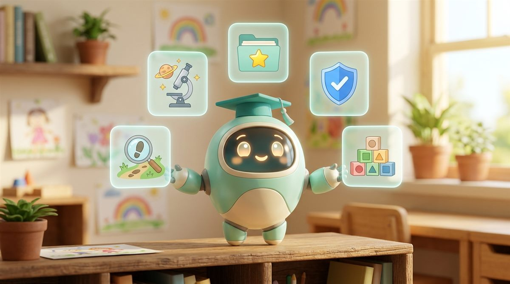
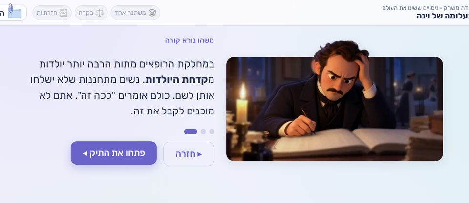



# הסקילים שלנו

**כישורים מוכנים לעוזר הדיגיטלי של המורה**

שולחים לעוזר את הקישור או את הקובץ של סקיל, והוא יודע לבנות, לבדוק ולנהל את מה שמורות כמוך כבר בנו, בדקו ושיפרו בכיתה.

[סקילים לטאב](#סקילים-לטאב) &nbsp;|&nbsp; [סקילים ל-Claude](#סקילים-ל-claude) &nbsp;|&nbsp; [איך משתמשים](#איך-משתמשים) &nbsp;|&nbsp; [English](#english)

## מהו סקיל?

סקיל הוא מסמך הוראות (`SKILL.md`) שהעוזר הדיגיטלי קורא ומבצע. הוא מכיל את הידע, הכללים והדוגמאות שכבר נבדקו בעבודה אמיתית עם תלמידים, כדי שהעוזר לא יתחיל מאפס ולא יחזור על טעויות. לעתים הסקיל מגיע עם סקריפטים, תבניות ודוגמאות חיות.

הריפו הזה מחולק לשניים:

| תיקייה | למי זה מיועד |
|---|---|
| [`tab-skills`](tab-skills) | סקילים לטאב: העוזר האישי של המורה, שבונה ומארח אתרים ב-`sites.tab.bot` |
| [`claude-skills`](claude-skills) | סקילים ל-Claude (Claude Code ו-claude.ai), לעבודה עם קבצים, טפסים, מצגות ואתרים |

---

## סקילים לטאב

<table dir="rtl">
<tr>
<td width="50%" valign="top">

### מעבדת בלש
**חקר שמחייב לחשוב**

הופכים שיעור למסע חקירה. התלמידים הם החוקרים בתוך סיפור עם מקום, זמן ותעלומה. הם אוספים ראיות לפנקס חוקר שתמיד גלוי, מריצים ניסוי שמשנים בו דבר אחד בלבד, ומחליטים מה העיקר ומה התפל. אי אפשר להתקדם בניחוש, כי חשיבה משתלמת.

- הליבה (מקום החשיבה) חובה, וכל השאר תפריט דפוסים לבחירה
- שאלות הוגנות: סדר מעורבב, בלי רמזים בצבעים, מסיחים שהם טעויות אמיתיות
- תבניות פרומפט להעתקה, ודוגמה חיה: [התעלומה של וינה](https://semmelweis-lab.sites.tab.bot/)

[דף הסקיל](https://lab-skill.sites.tab.bot/) &nbsp;|&nbsp; [SKILL.md](tab-skills/lab-skill/SKILL.md) &nbsp;|&nbsp; [PDF](tab-skills/lab-skill/lab-skill.pdf)

</td>
<td width="50%" valign="top">

</td>
</tr>
<tr>
<td width="50%" valign="top">

### הדמיות מדע
**שיעור אחד, הדמיה אחת, לכיתה ז׳**

הדמיה אינטראקטיבית שנראית טוב בטלפון ובמקרן. הפיזיקה מדויקת, המונחים כמו בכיתה, ושום דבר לא מרחף באוויר. יש שתי רמות (בסיס ומתקדם), חקירה חופשית, אתגר וטבלת נתונים עם רמזים ממוקדים.

- שפה עיצובית אחידה: פלטה רכה, Rubik, אייקוני Lucide
- התקדמות שנשמרת, מסך סיכום ושאלות הוגנות
- חיבור למעבדות: עם קוד כיתה כל משימה מגיעה למורה

[דף הסקיל](https://sim-skill.sites.tab.bot/) &nbsp;|&nbsp; [SKILL.md](tab-skills/sim-skill/SKILL.md)

</td>
<td width="50%" valign="top">

### דרייב למורים
**הכול במקום אחד**

תיקייה פרטית מסודרת לכל החומרים: סרטונים, תסריטים, דפי עבודה ומעבדות, לפי פרויקטים. חיפוש מהיר גם בלי ניקוד, לוח פרויקטים עם תעדוף בגרירה, ועוזר שמעדכן לבד פעם או פעמיים ביום.

- קישור העלאה לעמית או לכלי בינה מלאכותית אחר, לתיקייה אחת בלבד
- גיבויים מוצפנים שנבדק שהם באמת משתחזרים
- כולל חבילה מלאה: סקריפטים, אתר ושרת

[דף הסקיל](https://drive-skill.sites.tab.bot/) &nbsp;|&nbsp; [חבילה](tab-skills/drive-skill) &nbsp;|&nbsp; [PDF](tab-skills/drive-skill/explainer.pdf)

</td>
</tr>
<tr>
<td width="50%" valign="top">

### בקרה לפני פרסום
**לפרסם בראש שקט**

לפני שמשהו עולה לרשת, העוזר עובר על שמונה בדיקות: אבטחת מידע, פרטיות תלמידים, זכויות יוצרים, קרדיטים, נגישות (ת״י 5568 ו-WCAG 2.1 AA), דיוק מדעי, מפתחות תשובות והגנת סיסמה. מקבלים דוח קצר, והפרסום נעצר עד שהכול עובר.

- מה שאפשר לתקן, העוזר מתקן לבד
- רוצה לפרסם בכל זאת? ההחלטה שלך, והיא נרשמת במילים שלך
- בדיקות אוטומטיות ב-Node, בלי תלויות

[דף הסקיל](https://safe-publish-skill.sites.tab.bot/) &nbsp;|&nbsp; [חבילה](tab-skills/safe-publish-skill)

</td>
<td width="50%" valign="top">

### משחק אוצר מילים
**אנגלית, עותק משלך**

העוזר בונה עותק של משחק אוצר המילים לפי הספר והכיתה שלך. התלמידים לומדים בכרטיסיות, התאמות, חידון, איות, סיפורונים ואלבום מדבקות, וקונים פרסים בכוכבים. האתר מראה רק הצלחות: אין איקסים ואין ספירת טעויות.

- שולחים רשימות מילים לפי יחידות ומאשרים טבלה אחת
- בלי הרשמה ובלי שמות, וההתקדמות נשמרת במכשיר
- אפשר לשלוח לנו את הקישור, והמשחק יופיע באתר האנגלית לכל המורות

[דף הסקיל](https://vocab-skill.sites.tab.bot/) &nbsp;|&nbsp; [SKILL.md](tab-skills/vocab-skill/SKILL.md)

</td>
</tr>
</table>

---

## סקילים ל-Claude

סקילים לעבודה עם Claude, שנבנו מעבודה אמיתית של מורה. חלקם מניחים סביבת עבודה מסוימת (Windows, חשבונות וכלים של הכותבת), ולכן כדאי להתאים אותם לפני שימוש.

| סקיל | מה הוא עושה |
|---|---|
| [`tnufa-style-exam`](claude-skills/tnufa-style-exam) | מבדק מקוון בסגנון תנופה: נוסחים א/ב, כתיבה בלי הדבקה, לוח בדיקה עם כוכבים והצעות ניקוד של סוכן, תמונה כיתתית ומשוב מפורט לתלמידות. Apps Script ו-Google Sheets |
| [`tnufa-exam-author`](claude-skills/tnufa-exam-author) | כתיבת שאלון (יחידות, שאלות, תבחינים, נוסחים ומועד ב) בפורמט שמדביקים בגיליון של ערכת המבדק. מתאים ל-Claude וגם כ-Gem ב-Gemini |
| [`sirkuni-upload`](claude-skills/sirkuni-upload) | הכנת סט שאלות עם תמונות והעלאה לסרקוני, עם קישור ישיר לסט |
| [`pisga-course-form`](claude-skills/pisga-course-form) | מילוי טפסי בקשה להקמת פתרון למידה (פסגה), כולל חישוב שעות אקדמיות וסילבוס |
| [`canva-presentation-build`](claude-skills/canva-presentation-build) | בניית מצגת ב-Canva מתוך שקפים מעוצבים קיימים, בלי מחולל |
| [`canva-to-rezef`](claude-skills/canva-to-rezef) | ייבוא משאבי שיעור ממצגת רצף ב-Canva לכלי הרצף של חומר פתוח |
| [`geg-event-wrapup`](claude-skills/geg-event-wrapup) | סיכום אירוע של קהילת GEG: הקלטה, יוטיוב ועמוד סיכום באתר |
| [`launch-polish`](claude-skills/launch-polish) | בדיקות לפני פרסום אתר: תצוגה מקדימה, אייקון, SEO, אנליטיקס, מוכנות לסוכנים |
| [`promo-video`](claude-skills/promo-video) | סרטון תדמית עם Remotion, בעברית וב-RTL, בשני יחסי תמונה |
| [`youtube-cover`](claude-skills/youtube-cover) | קאבר ליוטיוב בסגנון קבוע, בלי בעיות של טקסט עברי בתמונה |

---

## ערכת מבדק בסגנון תנופה (בלי קוד)

[`exam-kit`](exam-kit) היא ערכה שמורה מעתיקה כגיליון Google (עם הסקריפט שבתוכו), מוסיפה שאלון שכתבה עם בינה מלאכותית, ופורסת בכמה לחיצות. כוללת אתר לתלמידות, לוח בדיקה עם כוכבים, משוב מפורט עם קוד אישי, ותמונה כיתתית. הצעות ניקוד אופציונליות מ-Gemini, עם מפתח API שמדביקים בתא ייעודי בגיליון (לא בקוד ולא בשיחה), ובלי שמות תלמידות.

1. משכפלים את גיליון התבנית. 2. מתקינים (תפריט "מבדק") ומדביקים שאלון שנכתב עם הסקיל [`tnufa-exam-author`](claude-skills/tnufa-exam-author) (או כ-Gem מתוך `gem-instructions.md`). 3. פורסים כאפליקציית אינטרנט. 4. מדביקים מפתח Gemini ומקבלים הצעות ניקוד. מדריך מלא: [exam-kit/README.md](exam-kit/README.md).

---

## איך משתמשים

### בטאב
1. פותחים את דף הסקיל (הקישורים למעלה) ורואים בדיוק מה מקבלים.
2. שולחים לטאב את הקישור, וכותבים לו במילים שלך מה את רוצה, למשל: *"תתקין לי את הבקרה לפני פרסום לפי הדף הזה"*.
3. הטאב שואל מה שחסר לו, וחוזר עם תוצר מוכן וקישור. סקילים עם חבילה (`drive-skill`, `safe-publish-skill`) אפשר גם להוריד כ-ZIP ולפתוח בתיקיית הקבצים של הטאב.

### ב-Claude
- **Claude Code:** מעתיקים את תיקיית הסקיל אל `~/.claude/skills/` (ב-Windows: `%USERPROFILE%\.claude\skills\`).
- **claude.ai:** הגדרות, Capabilities, Skills, העלאת סקיל, עם קובץ ZIP שתיקיית הסקיל בשורשו (`<skill>/SKILL.md`).

---

## טיפים לפני שמתחילים

- סקילים מסוימים מתעדים סודות (מפתחות, כתובות העלאה אישיות). הסודות לא נכללים כאן, וכל מורה מחזיקה את שלה במקום נעול, אף פעם לא בקובץ שמשתפים.
- כל סקיל נבנה סביב טעויות אמיתיות שתוקנו. אם משהו עבד אצלך טוב או שבר משהו, נשמח לשמוע.
- יש לך סקיל שבנית עם הטאב? אפשר להוסיף אותו לכאן.

[שליחת משוב או סקיל חדש](mailto:chepti@gmail.com?subject=%D7%A1%D7%A7%D7%99%D7%9C%D7%99%D7%9D%20%D7%A9%D7%9C%D7%A0%D7%95)

---

## English

Teacher skills in Hebrew for AI assistants. **`tab-skills`** are for Tab (a teacher's personal assistant that builds and hosts sites on `sites.tab.bot`): a detective-style inquiry lab, grade-7 science simulations, a private teacher drive, a pre-publish safety gate (security, student privacy, copyright, accessibility, scientific accuracy) and a vocabulary game. **`claude-skills`** are for Claude Code and claude.ai: a Tnufa-style online exam with a grading board and AI-suggested scores, form filling, Canva decks, launch checks, promo videos and YouTube covers. Each folder is self-contained and starts with a `SKILL.md`.

נבנה על ידי [חולמים תקשוב](https://chepti.com)

